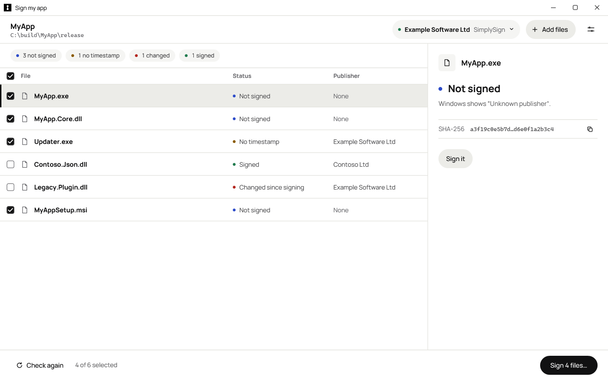
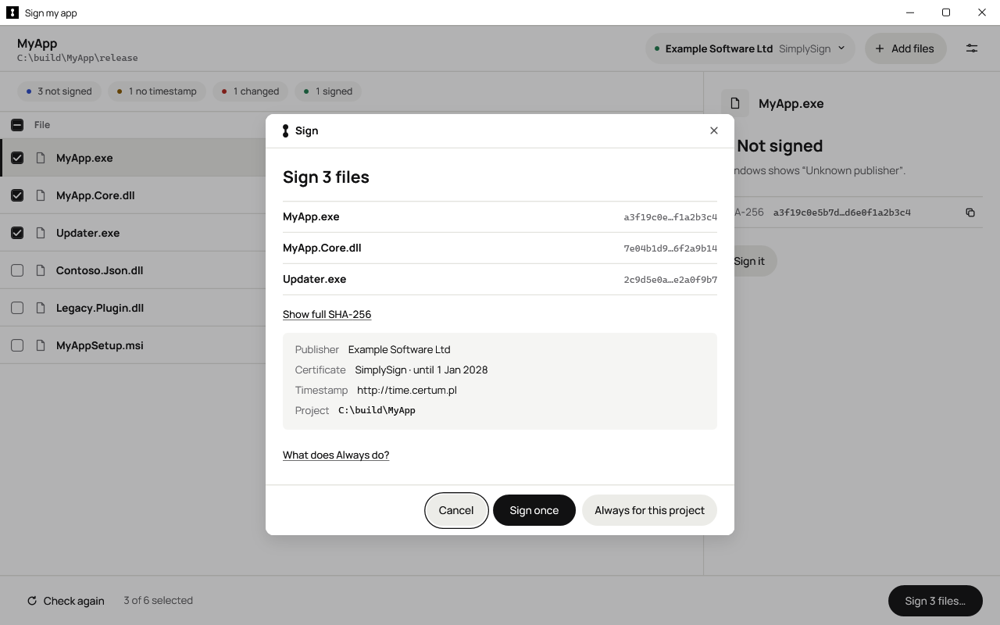

# Sign my app for Windows

A free, open source ([MIT](LICENSE)) Windows app that checks whether `.exe`, `.dll` and `.msi` files are signed, who signed them, whether they have a timestamp and whether they have changed since signing. Checking needs no certificate. To sign files, use any code signing certificate Windows SignTool can access, including SimplySign, a USB token or the Windows certificate store. No account, no telemetry, and no network access except the timestamp server and Windows' own certificate checks.

## Download

[Get the signed .exe from Releases](../../releases/latest). Download `SHA256SUMS.txt` from the same release and compare its SHA-256 with the downloaded file:

```powershell
Get-FileHash -LiteralPath '.\SignMyApp-1.0.0-win-x64.exe' -Algorithm SHA256
```

Use the filename for your release. The hash must match before you open the app.

## Requirements

- Windows 10 or 11, x64.
- For signing: Microsoft SignTool (included in the Windows SDK) and your code signing certificate set up on the PC.

## Check and sign

Add your files or a project folder to check their signatures. Review the publisher, timestamp and file status. To sign, choose your certificate and review the exact files and SHA-256 hashes before confirming.



Checking signatures with sample files.



Reviewing files to sign with sample files.

For installers, sign your app files first, rebuild the installer, then sign the `.msi`.

## Safety

The app never asks for passwords, PINs or codes. Sign in through your certificate provider's own software.

It signs a copy of the exact bytes you reviewed, verifies the result and replaces the original only if the original is unchanged. Changed files need a fresh review. There is no run-time code compilation.

## Need a certificate?

[Get a code signing certificate](https://klarseal.com/code-signing/standard/?utm_source=github&utm_medium=readme&utm_campaign=sign-my-app-windows), or [sign from your coding agent with the companion skill](https://github.com/klarseal/sign-my-app).

## Build from source

.NET 10 Windows WPF app, engine and CLI. Signing uses Microsoft SignTool, a certificate thumbprint in `CurrentUser\My`, SHA-256 and an RFC 3161 timestamp.

From the repository root, with the .NET 10 SDK and Windows SDK SignTool installed:

```text
dotnet build SignMyApp.slnx -warnaserror
dotnet test SignMyApp.slnx
dotnet run --project src/SignMyApp.App -- --demo
dotnet run --project src/SignMyApp.Cli -- check C:\build\MyApp.exe
dotnet run --project src/SignMyApp.Cli -- sign --thumbprint <40-hex-thumbprint> C:\build\MyApp.exe
```

The CLI requires exact `SIGN` input or `--yes-i-reviewed <planhash>`. See `--help` for project, timestamp and explicit installer/other-publisher selection. Exit codes: 0 success, 1 check/signing failure, 2 invalid input or declined review, 130 cancellation.

Core entry points: `SignatureChecker`, `CertificateFinder`, `SignToolLocator`, `Signer`, `ProjectTrustStore`, `SettingsStore`. Shared contracts are in `Contracts.cs`. Settings and exact folder/thumbprint trust pairs share `%LOCALAPPDATA%\Klarseal\SignMyApp\settings.json`. Trust skips only confirmation; callers still compute a review.

Checking uses offline WinVerifyTrust and embedded PKCS#7 metadata. Untrusted signatures are `Error`. Signing verifies a reviewed snapshot, then hashes and writes the original through a handle denying concurrent writes/deletion. Cancellation discards snapshots; a final write already in progress finishes.

Tests open no windows, add no certificates to Windows stores, and clean temporary files/PFXs. PE fixture: a copy of the installed .NET host pack's unsigned `apphost.exe`. MSI fixture: a temporary copy of `C:\Windows\Installer\103f2bbb.msi`, with signature streams removed through Windows structured storage. The original MSI and `C:\Program Files\dotnet\dotnet.exe` are checked read-only for trusted signatures/timestamps. Tests that need SignTool or the cached MSI fixture skip when unavailable; PE checks still run when the MSI is missing. A test-only untrusted-root override permits self-signed verification. Network tests skip unless `SIGNMYAPP_NET_TESTS=1`. SignTool PFX tests may need to run outside a restricted sandbox for Windows cryptography access.

The solution includes both the WPF app and its tests. `--demo` opens the app with in-memory sample files, certificates, signing and settings. Omit `--demo` to use the real engine. These run commands open the app; build and test commands do not. App render tests measure and render views off-screen at 1280×800 and 1024×640, writing PNGs to `tests/artifacts/`. Assembly scans cover App, Core and CLI for run-time compilation references.

`WindowChrome` keeps native drag, double-click, system menu and snap behaviour. Its `GlassFrameThickness="0,0,0,1"` restores the native DWM shadow; DWM owns its active/inactive intensity. `DWMWA_WINDOW_CORNER_PREFERENCE` requests rounded Windows 11 corners. `DWMWA_BORDER_COLOR` follows the active/inactive tokens; a failing HRESULT selects a square, one-physical-pixel WPF border on Windows 10. Maximizing removes both native and fallback borders and requests square corners. Activation, deactivation, state and DPI changes refresh the edge. The caption and app/settings headers share grey-50, with a single bottom baseline and white certificate/Add files pills. Certificate details show the issuer, publisher and validity dates.

The custom maximize/restore button returns `HTMAXBUTTON` in screen pixels for Windows 11 Snap layouts; its non-client mouse handling preserves hover, press, release-outside cancellation and mouse capture. Maximized content uses `SystemParameters.WindowResizeBorderThickness` to avoid the invisible frame overhang. The project header has no mark; the Sign header uses the original ink vector path. Selected file rows use grey-100 with an inset 3 px ink bar. Keyboard focus adds the full 1.5 px ring; clicking an already-focused row clears it, and entering the list from a mouse action does not add it.

`src/SignMyApp.App/Assets/klarseal.ico` is committed with PNG frames at 16, 24, 32, 48 and 256 px, embedded both as the executable icon and as the WPF window icon. Re-author it off-screen using `powershell -NoProfile -NonInteractive -STA -File build/New-AppIcon.ps1 -SourceSvg "assets/<source.svg>"` (optional `-Output`). The default source is `assets/klarseal-mark-square-white-on-black.svg`. This uses installed WPF geometry/bitmap APIs only; the app performs no SVG conversion or run-time compilation.

Startup sets the process AppUserModelID to `Klarseal.SignMyApp` before any UI for taskbar identity and grouping. `Window.Icon` loads a `BitmapFrame` retaining its `IconBitmapDecoder`. Tests verify the registered ID, decode every ICO frame and compare both native extracted EXE icons pixel-for-pixel with the ICO.

Full-window render tests include the production `TitleBar` control. `4.6-window-edge-and-app-icon.png` renders active/inactive window-edge previews and five icon sizes; its shadows and corners are static design previews, not captures of native DWM. `4.6-title-bar-states.png` renders the six caption states; `4.6-maximize-restore-states.png` checks both maximize/restore glyphs in active, hover and pressed states. Tests exercise DWM colour conversion/selection and unsupported-attribute fallback through an injected attribute writer, plus band/pill/selection styling, accessibility, insets, signed-coordinate hit mapping and icon resources without creating an HWND. Native shadows, shell grouping, gestures and the OS flyout require manual testing in the running app.

App preferences (timestamp address and language), CLI preferences and project trust use Core's single settings document; there is no `preferences.json` or migration. Saving preferences preserves trusted projects, and forgetting a project preserves preferences. The App integration tests reuse Core's test-only PFX helper because the production Signer deliberately accepts only a store thumbprint. Offline tests verify “Not signed”, untrusted-root errors and “No timestamp”. Set `$env:SIGNMYAPP_NET_TESTS = "1"` in PowerShell before `dotnet test` to also verify the unsigned-apphost → timestamped signature → “Signed” view-model flow against the timestamp service. No certificate is installed in a store.

### Release

Publish an unsigned, self-contained single-file Windows x64 app from the repository root:

```text
dotnet publish src/SignMyApp.App/SignMyApp.App.csproj -c Release -r win-x64 --self-contained true -p:PublishSingleFile=true -p:IncludeNativeLibrariesForSelfExtract=true -o publish/win-x64
```

The output is `publish/win-x64/SignMyApp.exe`. The maintainer signs releases separately; publishing does not sign the app. Microsoft SignTool and the signing certificate/provider must still be installed on the PC used to sign files.
